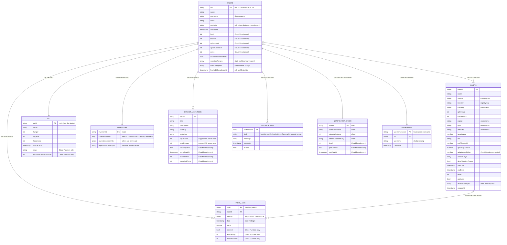

# Nori — Database Diagram

Logical entity-relationship view of the Firestore database on project `nori-pet`. Firestore is
a document database, so there are no foreign-key constraints: every "relationship" below is
either **containment** (a subcollection under `/users/{uid}`) or a **stored id** the app
resolves itself. The field-by-field description, write rules and rationale are in
[BACKEND.md](BACKEND.md) ("Firestore schema") and [firestore.rules](../../firestore.rules).

## Reading it

- **Everything except `USERNAMES` lives under `/users/{uid}`.** `HABITS`, `HABIT_LOGS`, `PET`,
  `INVENTORY`, `BUCKET_LIST_ITEMS`, `NOTIFICATIONS` and `NOTIFICATION_STATE` are subcollections
  of one user. `USERNAMES` is the only top-level collection besides `users`; it exists so
  username uniqueness can be enforced across users.
- **`HABIT_LOGS` is flat, not nested under a habit.** A log's id is `{dayKey}_{habitId}`, so
  there is at most one log per habit per day, and a month of history for every habit comes from
  one range query on `date`.
- **`PET`, `INVENTORY` and `NOTIFICATION_STATE` are one-document collections** (`main`), so they
  are shown as 1:1 with the user. The pet is a collection so that more pets can be added later
  without reshaping the data.
- **Not stored, on purpose:** the current streak and achievement unlock state are computed from
  the habit logs and the other entities. Achievement and care-item/accessory definitions are
  bundled app constants; `INVENTORY` stores only their string ids.
- **"Cloud Function only"** fields are rejected by the security rules on client writes. Only the
  Admin SDK (the Cloud Functions) can change them.
- **Not in the database:** the social tab (mock data only) and anything in Firebase Auth itself
  (password, providers), which lives in the Auth service rather than Firestore.
